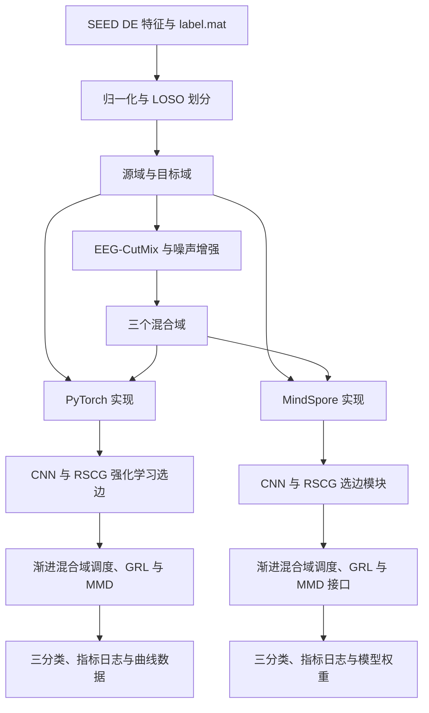

# 跨被试 EEG 情绪与意识状态识别

## 1. 项目介绍

本项目基于 2025 年发表于 *IEEE Transactions on Neural Systems and Rehabilitation Engineering (TNSRE)* 的论文 **A Progressive Multi-Domain Adaptation Network With Reinforced Self-Constructed Graphs for Cross-Subject EEG-Based Emotion and Consciousness Recognition**，研究跨被试 EEG 情绪与意识状态识别。

针对不同被试间 EEG 特征的分布差异，项目结合卷积特征提取、强化自构图（Reinforced Self-Constructed Graphs，RSCG）与渐进式多域适应，探索通道关系建模和跨被试特征对齐，为跨被试识别实验提供实现基础。

仓库包含 PyTorch 与 MindSpore 两套实现，当前数据管线和训练入口面向 SEED 三分类情绪识别。论文研究范围还包含意识状态识别，其对应数据与独立实验入口待确认。SEED-IV 及其他数据集的适配要求见环境说明。

## 2. 核心技术与技术架构

- **SEED 特征输入**。读取 MATLAB 文件中的 `de_movingAve` 字段，按 62 个通道、5 个频带处理，每个试次填充到 265 个时间点，形成每通道 1325 维特征。
- **归一化与 EEG-CutMix**。按被试对特征去均值并除以标准差，依据源域与目标域样本的余弦相似度进行特征拼接，再添加不同强度的高斯噪声，构造三个混合域。
- **LOSO 跨被试实验**。默认 15 折 Leave-One-Subject-Out，每折使用一个被试作为目标域，其余被试作为源域，目标域特征参与域适应。
- **CNN 与 RSCG**。三级 CNN 提取特征，三级图卷积通过通道特征相似性及 Top-k 选边构建图结构，融合多级图特征进行分类。
- **强化学习选边**。`RL.py` 与 `RL_mindspore.py` 定义边概率与 Top-k 选择模块，PyTorch 训练入口还包含奖励和策略损失计算。
- **渐进式多域适应、GRL 与 MMD**。训练调度器随 epoch 逐步增加参与训练的混合域，网络定义 GRL 域对抗分支，训练入口结合域判别损失与 MMD 特征对齐接口。
- **分类与输出**。网络输出三类预测及域特征。PyTorch 入口包含指标 CSV、AUC/ROC 数据与绘图保存逻辑，MindSpore 入口包含指标 CSV 和 `.ckpt` 权重保存逻辑。



图中展示现有模块及数据流。GRL 系数更新、MindSpore 选边优化和 MMD 缺失等实现限制集中说明于环境文档第 9 节。[实现差异与已知限制](docs/ENVIRONMENT.md)

## 3. 项目结构

以下列出当前仓库文件，`result/` 中的同类文件采用范围说明。

```text
mycode/
├── readme.md
├── .env.example
├── docs/
│   └── ENVIRONMENT.md
├── pytorch_version/
│   ├── README.md                       # 原有版本说明
│   ├── requirements.txt                # PyTorch 直接依赖清单
│   ├── main.py                         # 训练、LOSO 评估、日志与绘图
│   ├── datapipe.py                     # SEED 读取、归一化、增强及 PyG 数据缓存
│   ├── Net.py                          # CNN、RSCG、GRL 与分类网络
│   ├── RL.py                           # 强化学习选边模块
│   └── MMD.py                          # RBF 核 MMD
└── ICT_MindAligner_MindSporeVersion/
    ├── .gitignore
    ├── requirements.txt                # MindSpore 直接依赖清单
    ├── main_mindspore.py                # Ascend 训练、评估及 checkpoint 保存
    ├── datapipe_mindspore.py            # SEED 处理及 NPZ 数据集构建
    ├── Net_mindspore.py                 # MindSpore 网络与稠密图卷积
    ├── RL_mindspore.py                  # 选边模块
    ├── MMD_mindspore.py                 # 当前为空文件
    ├── Final_Visual.log                 # 已有实验控制台日志
    └── result/                         # 已有 CSV 与 checkpoint
```

`result/` 现有文件包括 `EEGAlignNet_MS_LOG_1.csv` 至 `EEGAlignNet_MS_LOG_5.csv`，以及 `best_model_cv00.ckpt` 至 `best_model_cv14.ckpt`。PyTorch 入口运行时使用版本目录下的 `processed/` 和 `result/`，MindSpore 入口使用 `processed_ms/` 和 `result/`，这些路径相对于启动时的工作目录。

## 4. 环境要求

| 实现 | 框架与直接依赖 | 当前源码设备设置 |
| --- | --- | --- |
| PyTorch | Python、PyTorch、PyTorch Geometric（PyG）、NumPy、Pandas、SciPy、scikit-learn、Matplotlib、tqdm | NVIDIA CUDA GPU，设备索引 0 |
| MindSpore | Python、MindSpore、NumPy、Pandas、SciPy、scikit-learn、tqdm | Ascend NPU，设备索引 0，PyNative 模式 |

Python 与操作系统应满足所选框架发行版要求。PyTorch/PyG 需匹配 CUDA 构建，MindSpore Ascend 需匹配驱动、固件和 CANN。依赖清单保留未锁定版本，实际训练环境信息待填写。安装步骤、环境记录表及检查命令见环境文档。[环境配置说明](docs/ENVIRONMENT.md)

## 5. 安装与运行指南

### 5.1 获取仓库与准备数据

```bash
git clone https://github.com/seizeall/mycode.git
cd mycode
```

自行按 SEED 数据集的申请及使用要求获取 `ExtractedFeatures` 特征目录，准备 15 个被试、每被试 3 个 session 的 `.mat` 文件，以及含 `label` 键的 `label.mat`。每个特征文件应有 15 个 `de_movingAve` 试次字段。仓库未附带 SEED 数据。

两套数据管线均依赖文件排序后每三个文件对应同一被试，需检查实际文件排序、被试/session 分组与特征形状。[数据准备要求](docs/ENVIRONMENT.md)

根目录 `.env.example` 提供六项配置参考。**当前源码尚未读取 `.env`，模板不会自动生效**。运行前需按环境文档第 9 节手动配置 SEED 路径、设备和训练参数。[手动配置位置](docs/ENVIRONMENT.md)

### 5.2 PyTorch 版本

从仓库根目录进入版本目录，在独立 Python 环境中，先按官方安装页选择适配本机的 CUDA 版 PyTorch，再安装 PyG 与其余依赖。

```bash
cd pytorch_version
# 先执行按平台选定的 PyTorch 安装命令
python -m pip install -r requirements.txt
# 完成数据路径和 CUDA 配置后，从当前目录启动训练
python main.py
```

训练入口内部调用 `build_dataset(subjects)` 完成预处理，随后执行 LOSO 训练与评估。输出为指标日志与曲线数据，当前入口未保存模型权重。

### 5.3 MindSpore 版本

从仓库根目录进入版本目录，使用独立的 Ascend 环境，先完成匹配的驱动、固件、CANN 和 MindSpore 安装，再安装清单中的其余依赖。

```bash
cd ICT_MindAligner_MindSporeVersion
# 先完成 Ascend 软件栈与匹配的 MindSpore 安装
python -m pip install -r requirements.txt
# 下列为训练入口，当前受空 MMD 文件阻塞
python main_mindspore.py
```

**当前 `MMD_mindspore.py` 为空文件，缺少入口导入的 `mmd_rbf`，训练会在导入阶段受阻。** 该限制需后续代码工作处理，详细说明见环境文档第 9 节。

MindSpore 将 checkpoint 写到固定的 `best_model_cvXX.ckpt` 文件名。后续实验应在独立仓库副本中运行，以保留本仓库已有权重和日志。上述安装与训练命令作为操作说明，本次未执行安装或完整训练。

## 6. 实验结果

当前实验代码采用 15 被试 LOSO 协议，每折目标被试特征参与适应，逐 epoch 在目标被试上评估。`Best_Vacc` 记录该折目标被试准确率的最高值，PyTorch 同时记录 `Best_Epoch`。两个入口均按目标被试准确率选择最佳 epoch，报告结果时应注明该选择方式。

- 已有 MindSpore 结果位于 `ICT_MindAligner_MindSporeVersion/result/`。`EEGAlignNet_MS_LOG_1.csv` 至 `EEGAlignNet_MS_LOG_3.csv` 为空白日志，`EEGAlignNet_MS_LOG_4.csv` 和 `EEGAlignNet_MS_LOG_5.csv` 含 `Subject`、`Best_Vacc` 两列及被试 0–14 的记录。
- `ICT_MindAligner_MindSporeVersion/Final_Visual.log` 含逐被试训练进度、准确率及汇总记录。不同记录的数值存在差异，具体数值应按文件和实验批次引用，批次与权重的对应关系需人工确认。
- 现有权重位于同一 `result/` 目录，文件名从 `best_model_cv00.ckpt` 到 `best_model_cv14.ckpt`。
- PyTorch 的 `evaluate` 计算 Accuracy、macro F1 和 macro OVR ROC-AUC，训练主循环主要记录 Accuracy 与 AUC。MindSpore 的 `evaluate` 计算 Accuracy 与 macro OVR ROC-AUC，当前 CSV 保存 `Best_Vacc`。现有结果文件未提供 F1 或 AUC 的完整汇总表。

当前仓库未附 PyTorch 实验结果文件。已有日志与当前代码版本的对应关系待确认，本次未复现实验。

## 7. 团队信息

以下为三人参赛项目团队分工，姓名由团队成员自行填写。

| 成员 | 姓名 | 角色 | 职责 |
| --- | --- | --- | --- |
| 成员一 | 陈佳俊 | 项目负责人、技术统筹 | 总体规划、技术架构、任务协调和材料整理。 |
| 成员二 | 吴筱筱 | 算法与实验负责人 | EEG 数据处理、跨被试算法研究、模型训练和评估。 |
| 成员三 | 周子蕴 | 框架适配与工程负责人 | PyTorch/MindSpore 适配、环境部署、运行验证和技术文档。 |

## 8. 论文引用与致谢

原论文作者为 Rongtao Chen、Chuwen Xie、Jiahui Zhang、Qi You 和 Jiahui Pan。以上信息来自原始引用，参赛项目团队见第 7 节，填写团队信息时应保留原论文署名。

使用原论文方法或代码时，请引用以下文献。BibTeX 保留原 README 的完整字段。

```bibtex
@ARTICLE{11142795,
  author={Chen, Rongtao and Xie, Chuwen and Zhang, Jiahui and You, Qi and Pan, Jiahui},
  journal={IEEE Transactions on Neural Systems and Rehabilitation Engineering},
  title={A Progressive Multi-Domain Adaptation Network With Reinforced Self-Constructed Graphs for Cross-Subject EEG-Based Emotion and Consciousness Recognition},
  year={2025},
  volume={33},
  pages={3498-3510},
  keywords={Brain modeling;Emotion recognition;Electroencephalography;Accuracy;Feature extraction;Adaptation models;Probability distribution;Noise measurement;Emotional responses;Computational modeling;Electroencephalogram (EEG);emotion recognition;consciousness recognition;domain adaptation;reinforcement learning},
  doi={10.1109/TNSRE.2025.3603190}}
```

感谢原论文作者及代码贡献者。原 README 提供的联系邮箱予以保留。[chenrongtao@m.scnu.edu.cn](mailto:chenrongtao@m.scnu.edu.cn)
